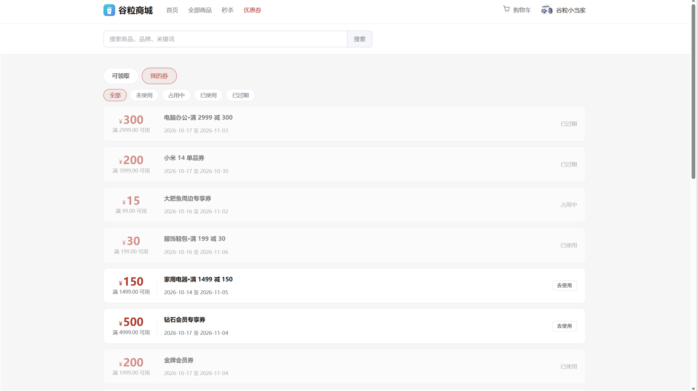
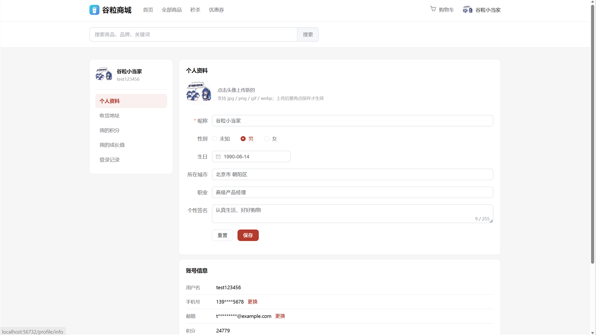
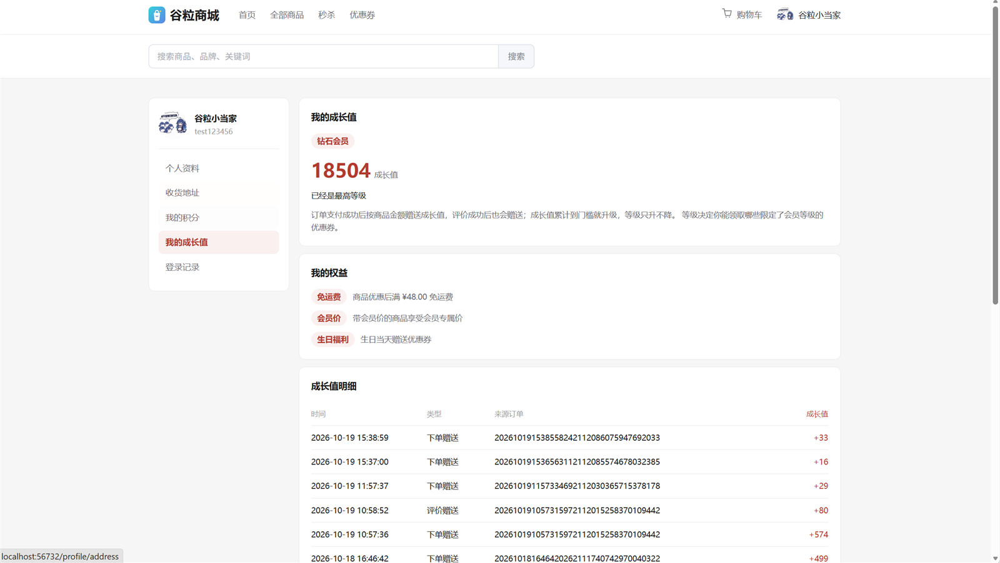
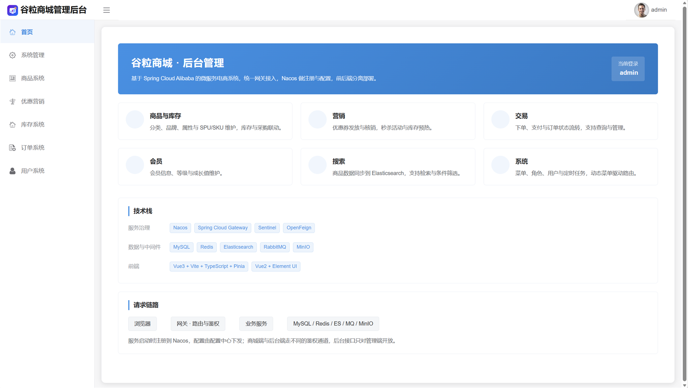
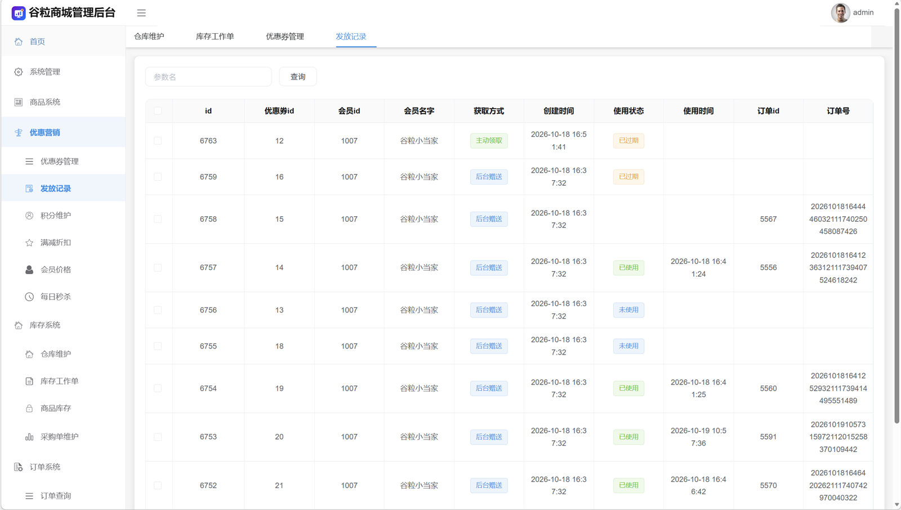

# smart-mall

谷粒商城是一个 Spring Cloud 微服务电商系统：Maven 多模块、前后端分离，一个网关 + 一组按域拆分的业务服务（商品、订单、券、会员、库存、检索、认证、购物车、秒杀、三方）+ 后台管理服务端，配用户端与后台管理两个前端。技术栈是 Spring Boot / Spring Cloud，Vue 3 + Vite + TypeScript（用户端）、Vue 2 + Element UI（后台管理），数据侧 MySQL、Redis、Elasticsearch、RabbitMQ、Nacos、MinIO。

教程把主链路做成了一个能跑通的骨架：商品分类 / 品牌 / 属性 / SPU / SKU 到上架写 ES、ES 检索、三条登录链路、购物车、订单（含延迟关单）、秒杀（Sentinel + Zipkin），再加后台管理里由代码生成器吐出来的一批增删改查。缺口也在这里：优惠券和促销只有表结构与脚手架接口，会员等级、权益、发货收货、售后、评价都没有业务闭环，跨服务一致性没有设计（删商品要不要清 ES、扣库存失败怎么回滚，全靠临场决定），ES 只停在关键字匹配，前端还是 Thymeleaf 服务端渲染。

因此改造分三层：前端换成独立 SPA —— 用户端重写，后台管理保留但跟进契约；地基补齐 —— 鉴权收口到网关、统一响应契约、MQ 拓扑与 outbox、容器化；业务只挑有状态、有并发、有失败回滚的链路做穿 —— 优惠券 → 订单联动、订单履约闭环到评价、售后两条链。每一层都留了可复现的实测结论。

## 项目

功能不是挑着做的，各域都通，按真实交易顺序连起来是：

**浏览 → 加购 → 结算 → 下单 → 支付 → 发货 → 收货 → 评价 → 售后**

| 域 | 功能 |
|---|---|
| 商品 | 三级分类树、品牌、平台属性（规格参数）、SPU/SKU 联合保存、图集写入排序与默认图、上架写 ES、下架、商品详情用线程池异步编排组装、配置类表按业务键覆盖保存、按引用关系做删除守卫（分类整棵子树级联清零，删商品先查券范围与订单引用） |
| 检索 | ES 索引与 ik 分词、关键字、分类/品牌/属性筛选、聚合收窄、价格区间、排序、分页 |
| 认证 | 短信、QQ 社交、邮箱验证码三条登录链路；JWT 取代 Session，网关统一验签并下传身份头，登录记录 IP 与归属城市 |
| 会员 | 资料与收货地址（每人恰好一条默认，支持换绑）、等级与成长值、积分流水、锁定账号拦截登录 |
| 购物车 | Redis 存取、登录后合并、改数量与勾选 |
| 促销 | 满减、阶梯、会员价、SPU 积分规则、免邮门槛的配置与读取侧全接通 |
| 交易 | 结算五段算价（满减/阶梯/会员价/券/积分抵扣）加等级免邮，逐项分摊到行；防重令牌、库存锁定、券占用同时生效；延迟队列 60 秒关单；订单软删硬删与操作史留痕 |
| 支付 | 模拟第三方支付平台（独立容器 + 收银台 + 回调转发）、支付回调幂等、金额对账、交易流水落库 |
| 履约 | 发货与出库实扣、库存工作单只做台账、手动/自动确认收货共用一条 UPDATE、后台订单与库存工作单列表业务化 |
| 评价 | 会员评价绑定来源订单项、公开评论区按 SPU 聚合、回复、点赞、后台审核只给下架与恢复 |
| 售后 | 仅退款与退货退款共用一张申请表按 `type` 区分；先平台退款再改本地；三处刻意不退（库存/券/赠送权益） |
| 优惠券 | 模板管理、定向发放与停发、领券限领、我的券、可用券筛选、算价占用、核销、退回、过期清理、生日赠券、券列表六维筛选 |
| 秒杀 | 场次与关联商品、手动上架下架（分布式锁收敛）与级联清缓存、信号量限购、订单异步落库 |
| 仓库 | 仓库与库存、需求单/采购单状态机（守卫、查询条件、可执行动作共用一份判断）、合并同仓需求、入库、按发货仓距离分档运费、删采购单不回滚库存 |
| 用户端 | 独立 SPA（Vue 3 + Vite + TS + Pinia），10 个顶层路由：首页 / 检索 / 详情 / 秒杀 / 购物车 / 结算 / 我的订单 / 支付 / 个人中心 / 优惠券；15 个 Thymeleaf 模板与 Session 依赖全删 |
| 后台管理 | 菜单/角色/用户、商品与订单、促销与券、会员、秒杀、文件上传（MinIO）、操作留痕；跟随契约与菜单对齐，视觉换成本项目自己的品牌 |
| 平台 | 网关（鉴权 + 路由 + 跨域，唯一入口）、统一响应 `R<T>` 与 `PageQuery`/`PageVO`、统一校验与错误码、MQ 拓扑与 outbox 收进 `common`（唯一目录、唯一声明入口、唯一发送门面，跨服务一致性：拦截走同步 Feign、清理走异步）、Nacos 配置中心（动态刷新 / 回滚 / 本地快照）、Sentinel、Zipkin、MySQL 时区统一 CST、每服务一个 Dockerfile + 全栈 compose + 指纹增量构建 |

数据规模与实测：15 个 SPU / 141 个 SKU、1000 个测试会员、36 张券模板、5 个秒杀场次；800 并发抢 50 件秒杀三方对账一致，订单全链路 239 项断言通过，超卖、重复提交、券并发占用三个并发点都有数据。

## 界面

<table>
  <tr>
    <td width="50%"></td>
    <td width="50%"></td>
  </tr>
  <tr>
    <td align="center"><sub>用户端 · 商品列表</sub></td>
    <td align="center"><sub>用户端 · 我的券（未使用 / 占用中 / 已使用 / 已过期）</sub></td>
  </tr>
  <tr>
    <td width="50%"></td>
    <td width="50%"></td>
  </tr>
  <tr>
    <td align="center"><sub>用户端 · 个人资料</sub></td>
    <td align="center"><sub>用户端 · 成长值、等级与权益</sub></td>
  </tr>
  <tr>
    <td width="50%"></td>
    <td width="50%"></td>
  </tr>
  <tr>
    <td align="center"><sub>后台管理 · 首页</sub></td>
    <td align="center"><sub>后台管理 · 优惠券发放记录</sub></td>
  </tr>
</table>

## 架构与仓库

```
              浏览器
                │
        ┌───────┴────────┐
   storefront(56732)  admin(56731)         用户端 / 后台管理，静态托管
        └───────┬────────┘
                │  http://localhost:53000/api
        ┌───────▼────────┐
        │ gateway  53000 │                鉴权、路由、跨域，唯一的业务入口
        └───────┬────────┘
   ┌────┬───────┼───────┬─────┬────────┐
product order coupon member ware search …  11 个业务服务，只在容器网络内可达
   └────┴───────┴───────┴─────┴────────┘
                │
   MySQL · Redis · Elasticsearch · RabbitMQ · Nacos · MinIO
```

| 仓库 | 是什么 | 怎么跑 |
|---|---|---|
| [`services`](https://github.com/smart-mall/services) | 后端：网关 + 11 个业务服务 + 后台管理服务端，含 compose 编排与镜像构建 | 见仓库 README |
| [`storefront`](https://github.com/smart-mall/storefront) | 用户端 SPA，Vue 3 + Vite + TypeScript | `npm run dev`，56732 |
| [`admin`](https://github.com/smart-mall/admin) | 后台管理，Vue 2 + Element UI | `npm run dev`，56731 |

业务服务一律不对宿主机暴露端口，直连不通是预期行为。

## 技术栈

- **基础设施**：MySQL 8、Redis、Elasticsearch 8、RabbitMQ、Nacos、MinIO
- **后端**：Spring Boot 2.6、Spring Cloud（Gateway / OpenFeign / LoadBalancer）、MyBatis-Plus、Sentinel、Zipkin
- **前端**：Vue 3 + Vite + TS + Pinia（用户端）、Vue 2 + Element UI（后台管理）
- **工程与运维**：Maven 多模块、Docker Compose、镜像指纹增量构建、Nacos 配置中心

## 快速开始

```bash
# 1. 起基础设施
docker compose -f gl-com.yml up -d gl-mysql gl-redis gl-nacos gl-es gl-rabbitmq gl-minio gl-sentinel gl-zipkin

# 2. 导入库表（幂等，可重复执行）
docker exec -i gl-mysql mysql -uroot -proot --default-character-set=utf8mb4 < assets/sql/init.sql

# 3. 全栈启动（后端镜像需先构建，见下）
docker compose -f gl-com.yml up -d
```

```powershell
# 后端镜像：按源码指纹增量构建，源码没变的不重建
.\build-images.ps1
```

起来后：用户端 <http://localhost:56732>、后台管理 <http://localhost:56731>、网关 <http://localhost:53000/api>。

## 关键实现

- **鉴权**：只在网关判定一处，业务模块零登录校验、端口不对宿主机暴露。
- **MQ**：拓扑与 outbox 收进 `common`，唯一目录 / 声明 / 发送口；拦截走同步，清理走异步。
- **券 → 订单**：限领在 `READ_COMMITTED` 下才正确，算价逐项分摊，占用 / 核销 / 退回 / 过期四边闭环。
- **履约**：回调幂等与对账、发货实扣、收货手动与自动共用一条 UPDATE。
- **删除**：按“谁的列里存着谁的 id”决定删谁、清谁。
- **容量**：券行锁 ≈100 TPS、网关是秒杀前门瓶颈、单线程后门 ≈22 单/s，全部实测。
